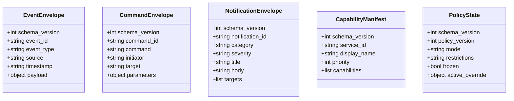

# Canonical Capability Contracts & Event Envelopes

This document details the Draft 2020-12 JSON Schemas, capability contracts, and envelope structures used across the ecosystem mesh.

## Overview

The contract schemas are maintained under `contracts/` and packaged as `ecosystem-schemas` (Python) and `@appecosystem/schemas` (Node/TypeScript).



---

## 1. Registered Capability Schema (`capability-manifest.v1`)

Services register their provided capabilities with `CapabilityRegistry`:

```json
{
  "schema_version": 1,
  "service_id": "openeye-surveillance",
  "display_name": "OpenEye Camera System",
  "priority": 50,
  "endpoints": {
    "http": "http://192.168.1.50:8200"
  },
  "capabilities": [
    {
      "name": "camera.stream",
      "version": "1.0",
      "action_class": "observe",
      "description": "RTSP/HLS video stream"
    },
    {
      "name": "device_scan",
      "version": "1.0",
      "action_class": "investigate",
      "description": "Trigger local endpoint scan"
    },
    {
      "name": "ecosystem.freeze",
      "version": "1.0",
      "action_class": "remediate",
      "description": "Engage emergency Freeze"
    }
  ]
}
```

---

## 2. Command Envelope (`command-envelope.v1`)

```json
{
  "schema_version": 1,
  "command_id": "01J00000000000000000000001",
  "command": "router.block_ip",
  "action_class": "contain",
  "initiator": "cyber-agents",
  "target": {
    "ip": "198.51.100.24",
    "router_id": "gw-01"
  },
  "parameters": {
    "ttl_seconds": 300,
    "reason": "Brute force attack detected"
  },
  "timestamp": "2026-11-01T21:00:00Z"
}
```

---

## 3. Policy State Envelope (`policy-state.v1`)

Consumed by `<ecosystem-policy-bar>` and dashboard UIs:

```json
{
  "schema_version": 1,
  "policy_version": 4,
  "mode": "normal",
  "restrictions": "on",
  "frozen": false,
  "freeze_info": null,
  "active_override": null,
  "always_enforced": [
    "command_authentication",
    "input_validation",
    "freeze",
    "target_authorization_and_consent",
    "cloud_budget_and_data_boundary",
    "tamper_evident_audit_log"
  ],
  "authority": "hub_synced",
  "updated_at": "2026-11-01T21:15:00Z"
}
```

