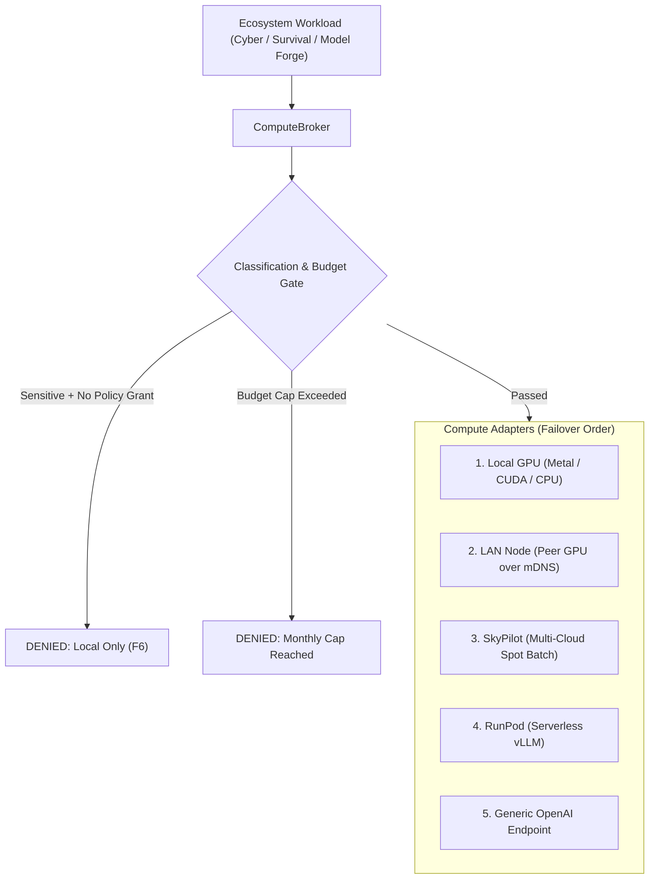

# Cloud GPU Providers & Compute Broker (`ecosystem-compute`)

This document describes the multi-provider compute architecture, cloud failover mechanisms, sensitive data egress gates, and hard budget caps in `ecosystem-compute`.

## Overview

The `ComputeBroker` (`packages/ecosystem-compute`) provides a single unified interface across local hardware, peer LAN nodes, and external cloud GPU clusters.



---

## 1. Supported Adapters

| Provider | Type | Latency | Typical Cost | Privacy Boundary |
|---|---|---|---|---|
| `local` | Metal / CUDA / ROCm / CPU | Lowest | \$0.00 | Data never leaves local device |
| `lan_node` | Peer device on LAN | Low (<5ms) | \$0.00 | Data stays on local network |
| `skypilot` | Batch jobs across AWS, GCP, Lambda, Vast | High (batch) | \$0.40 - \$1.20 / hr (spot) | Cloud egress (requires policy grant) |
| `runpod` | Serverless vLLM / Pods | Medium | Pay-per-second | Cloud egress (requires policy grant) |
| `generic_openai` | Any OpenAI-compatible URL | Variable | Pay-per-token or self-hosted | Dependent on base URL location |

---

## 2. Sensitive Data Classification Gate

Every compute job or endpoint specification carries a `classification`:
- `public`: General queries, benign knowledge retrieval -> Cloud allowed.
- `internal`: Internal telemetry, service metrics -> LAN or Cloud allowed.
- `sensitive`: Network router logs, packet captures, surveillance camera frames, forensic scan outputs -> **Local only**.

### Enforcement Invariant
If a workload carries `classification == "sensitive"`, `ComputeBroker` strictly refuses to dispatch the request to any cloud provider (`skypilot`, `runpod`, or remote `generic_openai`), raising `PermissionError`.
Cloud egress is only permitted when an authenticated operator explicitly issues an Ed25519-signed `data_release` approval checkpoint via `PolicyEngine`.

---

## 3. Hard Budget Caps

Cloud computing is metered and can incur unexpected charges if unconstrained. The broker enforces two deterministic limits configured in `compute.yaml`:

```yaml
enabled: false  # Cloud off by default (F6)
budget:
  monthly_usd: 50.00        # Maximum cumulative cloud spend per calendar month
  per_job_usd: 10.00        # Maximum allowed estimated cost for a single batch run
  max_runtime_hours: 4.0    # Hard auto-stop limit
```

- **Per-Job Cap**: If a proposed batch job's estimated cost exceeds `per_job_usd`, the job is rejected immediately with `ValueError`.
- **Monthly Cap**: Cumulative monthly expenditure is tracked in memory and persisted. When `monthly_usd_spent + estimated_cost > monthly_usd`, all cloud workloads are paused until the next billing cycle.

