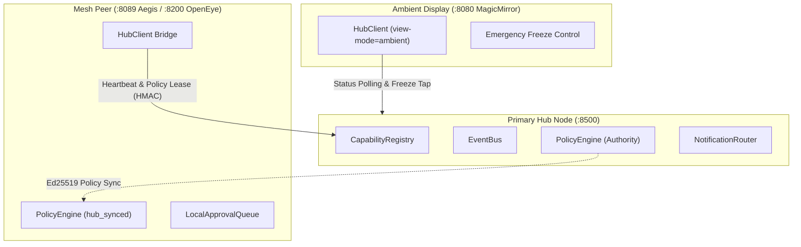

# Hub Operating Modes and Topology Architecture

This document describes the topology, discovery mechanisms, role election, and failover behavior of the `appEcosystem` mesh.

## Overview

The ecosystem operates across three mutually compatible deployment modes:
- **`standalone`**: A single device running one or more applications without external coordination. All policy decisions and approval queues remain local.
- **`hub_synced` (Federated Mesh)**: Multiple devices coordinated by a primary hub node running `ecosystem-hub`. Services register capabilities, subscribe to event streams, and synchronize signed policy states.
- **`edge`**: Resource-constrained or isolated endpoints (e.g. wall mirrors, mobile clients) that delegate heavy operations to peer nodes while retaining local emergency freeze capability.

---

## 1. Hub Roles & Deterministic Priority

When multiple hub candidates run on the same local network, role resolution follows deterministic priority:

| Project | Default Port | Role Priority | Notes |
|---|---|---|---|
| `appEcosystem` (`ecosystem-hub`) | 8500 | **100** | Dedicated mesh controller & registry |
| `AI-for-Survival` | 8000 | **100** | Primary fallback coordinator for survival offline mesh |
| `OpenEye-OpenCV_Home_Security` | 8200 | **50** | Mid-tier coordinator; surveillance & camera automations |
| `cyber-agents` | 8088 | **15** | Security automation daemon |
| `AegisSIEM` | 8089 | **10** | Threat intelligence and SIEM dashboard |
| `MagicMirror-Custom` | 8080 | **10** | Ambient wall display (client/consumer only) |

### Election Logic
1. Each node broadcasts mDNS (`_ecosystem._tcp.local.`) advertisements containing its `priority`, `service_id`, and `version`.
2. The candidate with the highest priority claims primary coordination. Ties are broken deterministically using lexicographical comparison of the node's Ed25519 public key fingerprint.
3. If no peer answers within the discovery window (default: 5.0 seconds), the local instance transitions to `standalone` mode and acts as its own local authority.

---

## 2. Discovery & Transport

- **mDNS / ZeroConf**: Peer discovery uses Zeroconf with type `_ecosystem._tcp.local.`. Services advertise their HTTP base URL, capability tags, and protocol versions.
- **Direct DNS / Static Fallback**: Nodes accept explicit configuration via `ECOSYSTEM_REGISTRY_URL` or `ECOSYSTEM_HUB_PEERS`.
- **Authentication**: All inter-service communications are cryptographically signed with HMAC-SHA256 (`X-Ecosystem-Signature`, `X-Ecosystem-Timestamp`, `X-Ecosystem-Nonce`). Replay windows are bounded to 300 seconds.

---

## 3. Heartbeats, Leases, and Failover

- **Heartbeat Cadence**: Enrolled services send heartbeats every 30 seconds (`/services/heartbeat`).
- **Health Check Failures**: If 5 consecutive health checks fail (150 seconds elapsed), the registry marks the service record as `unhealthy` and broadcasts `ecosystem.service_unhealthy` on the event bus.
- **Policy Leases**: Synced peers operate under signed policy leases. If a peer loses contact with the primary hub for more than `ECOSYSTEM_POLICY_LEASE_SECONDS` (default: 600 seconds), its authority downgrades to `lease_expired`. In `lease_expired` state:
  - Active `Restrictions: Off` overrides are immediately invalidated.
  - The node fails closed to conservative blue-team defaults.
  - Local passive observation and local emergency freeze remain operational.

