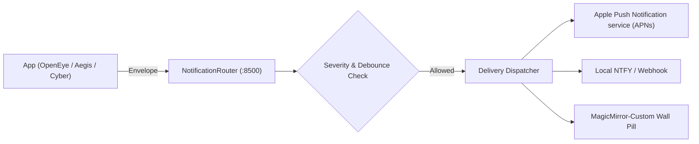

# Unified Notification Routing Architecture

This document describes notification envelopes, severity mapping, target resolution, debounce mechanics, and delivery channels in the `appEcosystem` mesh.

## Overview

The `NotificationRouter` (`F11`) collects notifications across all ecosystem services, validates them against `notification-envelope.v1`, and dispatches them to configured targets (local push, APNs, Webhook, NTFY, Pushover).



---

## 1. Notification Envelope (`notification-envelope.v1`)

All notifications conform to the canonical JSON Schema `notification-envelope.v1`:

```json
{
  "schema_version": 1,
  "notification_id": "01J00000000000000000000000",
  "source": "openeye",
  "category": "security",
  "severity": "high",
  "title": "Perimeter Breach Detected",
  "body": "Unrecognized person detected at Front Gate camera.",
  "timestamp": "2026-11-01T20:30:00Z",
  "targets": ["mobile_operator", "ambient_display"],
  "actions": [
    {
      "action_id": "freeze_now",
      "label": "Freeze Ecosystem",
      "capability": "ecosystem.freeze"
    }
  ],
  "metadata": {
    "camera_id": "cam_front",
    "confidence": 0.94
  }
}
```

---

## 2. Severity Levels and Filtering

Notifications specify one of four standardized severity levels:

| Severity | Description | Default Threshold |
|---|---|---|
| `critical` | Active breach, unauthorized physical entry, verified spyware IOC match | Immediate push to mobile targets; audio alert |
| `high` | Suspicious behavioral anomaly, failed step-up authentication, repeated scan gap | Standard push; visible on wall displays |
| `medium` | Routine scan findings, service health degrade, scheduled task execution | Logged to database; surfaced in dashboards |
| `low` | Periodic telemetry, service startup, routine heartbeat | Suppressed on mobile; available in audit log |

Wall displays (`MagicMirror-Custom`) configure `minSeverity: "medium"` to avoid screen clutter, only interrupting ambient layouts for security incidents and emergency freeze alerts.

---

## 3. Debounce and Cooldown Engine

Repeated notifications (e.g. repeated video motion frames or flapping network links) are debounced using composite keys:
- Cooldown Key: `(source, category, target_entity)`
- Configurable window: Default 60 seconds (customizable per rule).
- When debounced: Notification counters increment in database without generating duplicate mobile push alerts.

---

## 4. Delivery Channels

1. **Local Push / Webhooks**: POST request with signed HMAC headers delivered directly to enrolled LAN nodes.
2. **Apple Push Notification service (APNs)**: Low-latency push to iOS and macOS apps (`openeye-ios`, `aegissiem-ios`).
3. **Self-Hosted Push (NTFY / Pushover)**: Out-of-band alerts for air-gapped or private networks without third-party dependencies.

