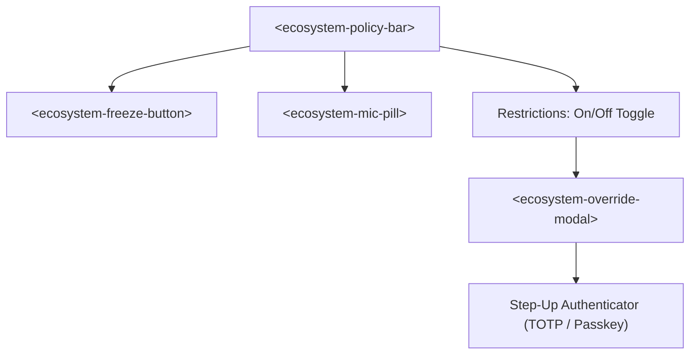

# Policy Dashboard Controls & Apple HIG Web Components

This document describes the design, layout guidelines, touch target requirements, and view-mode restrictions of `@appecosystem/ui-controls`.

## Overview

The user interface components conform strictly to the [Apple Human Interface Guidelines (HIG)](https://developer.apple.com/design/human-interface-guidelines), emphasizing clarity, deference, and depth.

### Component Suite

The suite is implemented as zero-dependency Vanilla Web Components in `packages/ecosystem-ui-controls`:

1. `<ecosystem-policy-bar>`: Top navigation bar displaying effective mesh mode, restrictions status, and emergency controls.
2. `<ecosystem-override-modal>`: Step-up authentication modal for activating timed, scoped `Restrictions: Off` overrides.
3. `<ecosystem-freeze-button>`: Direct emergency Freeze control with optional confirmation sheet.
4. `<ecosystem-mic-pill>`: Voice status indicator and push-to-talk trigger.

---

## 1. Apple HIG Principles & Touch Targets

- **44pt Minimum Touch Target**: Every interactive element (buttons, pills, dropdowns, modal triggers) has a minimum tap target of `44px × 44px`.
- **Non-Color State Indicators**: Status indicators never rely solely on color. Every indicator includes an explicit text label (e.g. `NORMAL`, `FROZEN`, `RESTRICTIONS: OFF`) and iconography.
- **High Contrast & Dark Mode**: Styled via `theme/ecosystem-theme.css`, supporting automatic `prefers-color-scheme` switching between light and dark modes with high WCAG AAA contrast ratios.
- **Deference & Depth**: Translucent materials (`backdrop-filter: blur(20px)`), subtle borders (`1px solid var(--eco-border-subtle)`), and layered elevation shadows.

---

## 2. View Modes (`view-mode`)

Components adapt their privilege and display density according to their assigned `view-mode`:

| View Mode | Target Environments | Capabilities & Restrictions |
|---|---|---|
| `admin` | AegisSIEM Dashboard, Cyber-agents Control Plane, Ecosystem Hub (`:8500/ui`) | Full operator capabilities: Resume, Mode Change, Step-up TOTP/Passkey overrides, Approval Queues |
| `operator` | OpenEye Surveillance UI, AI-for-Survival Operator Panel | Freeze, Scan Requests, Automation Triggers; Mode change requires Step-Up |
| `ambient` | MagicMirror-Custom, Wall Displays, Kiosks | **Emergency Freeze Only**. Privileged transitions (`resume`, `restrictions/off`, `approve`, `deny`) are completely hidden and hard-rejected with `ECOSYSTEM_POLICY_FORBIDDEN` |

---

## 3. Step-Up Authentication Flow

When an operator clicks `Restrictions: Off` in `<ecosystem-policy-bar>`:
1. `<ecosystem-override-modal>` opens with a native iOS/macOS sheet animation.
2. The operator must specify:
   - Explicit operator reason (cannot be blank).
   - Target devices scope.
   - Target action classes scope.
   - Override duration (e.g. 15m, 30m, 1h, 2h).
   - 6-digit TOTP code or WebAuthn Passkey assertion.
3. The server validates the factor and issues an Ed25519-signed override grant.
4. Upon expiration, the override automatically lapses and `PolicyEngine` fails closed back to `Restrictions: On`.

