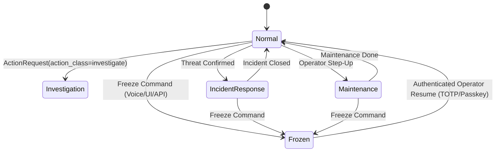

# PolicyEngine & Blue-Team Security Architecture

This document describes the design, cryptographic enforcement, state machine, and invariants of the `ecosystem-policy` engine.

## Overview

The `PolicyEngine` (`packages/ecosystem-policy`) provides deterministic blue-team governance over all autonomous and operator-directed actions.



---

## 1. Cryptographic Policy Document (`policy.yaml`)

The mesh policy is specified in `policy.yaml` and signed with an Ed25519 private key:

```yaml
policy_version: 3
mode: normal
freeze_info: null
active_override: null
authority: hub_synced

always_enforced:
  - command_authentication
  - input_validation
  - freeze
  - target_authorization_and_consent
  - cloud_budget_and_data_boundary
  - tamper_evident_audit_log

signature:
  algorithm: ed25519
  signer_fingerprint: a1b2c3d4e5f60718
  signature: "..."
```

### Fail-Closed Invariant
If `policy.yaml` is missing, unreadable, or carries an invalid cryptographic signature, `PolicyEngine` immediately fails closed to the conservative default blue-team policy:
- `mode = "normal"`
- Active overrides are rejected.
- All non-passive external recon is blocked.
- Automatic scans on unconsented targets are prohibited.

---

## 2. Invariants Never Bypassed

Even when an operator activates `Restrictions: Off`, the following six security invariants are strictly maintained:

1. **`command_authentication`**: Every action request must carry a verified caller identity (HMAC or verified bearer session).
2. **`input_validation`**: Strict parameter typing and schema validation.
3. **`freeze`**: Emergency Freeze pre-empts all actions except passive `observe`.
4. **`target_authorization_and_consent`**: External target scanning and endpoint scanning require independent cryptographic consent (AUP + device key fingerprint). `Restrictions: Off` does NOT grant authority to attack third parties.
5. **`cloud_budget_and_data_boundary`**: Hard dollar budget caps cannot be overridden by prompt; sensitive data egress to cloud requires separate signed `data_release`.
6. **`tamper_evident_audit_log`**: Every decision, override, freeze, and execution is appended to a SHA-256 hash-chained audit log.

---

## 3. Provisional Containment & Automated Rollback

For defensive containment actions (e.g. blocking a malicious IP address on a router):
1. `PolicyEngine.decide()` approves provisional containment with an execution deadline (TTL: default 300 seconds).
2. The action is applied provisionally to contain the immediate threat.
3. An approval checkpoint is placed in `LocalApprovalQueue`.
4. If an operator denies the request or the TTL expires before operator review, `PolicyEngine` triggers the automated rollback plan to unblock the target and restore normal routing.

