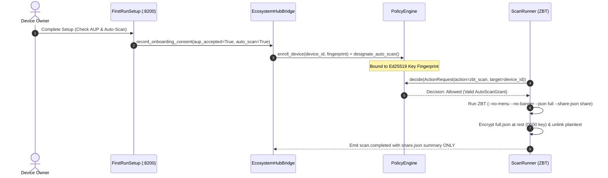

# Scan Authorization, Consent & Cryptographic Binding

This document describes the consent lifecycle, Acceptable Use Policy (AUP) enforcement, device-key binding, and data retention boundary for endpoint scans.

## Overview

The `ecosystem-scan` service (wrapping Zero-Breach-Toolkit) operates on a strict **Consent First** principle. Silence or omission never creates consent.

---

## 1. Consent Architecture

1. **AUP Enrollment (`enroll_device`)**:
   - The device owner explicitly reviews and accepts the endpoint scanning AUP.
   - Consent records capture: `device_id`, `owner`, `aup_version`, `timestamp`, and `public_key_fingerprint`.
2. **Device-Key Binding vs DHCP IP Churn**:
   - Consent is cryptographically bound to the device's Ed25519 public key fingerprint.
   - An IP change via DHCP lease expiration does **NOT** transfer scan authority to a newly connected device on that IP.
   - If `PolicyEngine` detects a fingerprint mismatch on a previously enrolled IP/device, the scan is blocked immediately (`decision.result = "deny"`).
3. **Revocation**:
   - Revoking consent instantly cancels pending scans and forbids scheduled runs (`PolicyEngine.revoke_auto_scan()`).

---

## 2. On-Demand vs Auto-Scan Grants

- **On-Demand Scans**: Initiated by an authenticated operator or authorized automation rule.
- **Auto-Scan Grants (`AutoScanGrant`)**:
  - Requires explicit designation during onboarding or via ecosystem policy settings.
  - Scoped to specific profiles (`quick` or `full`).
  - Scoped to allowed initiators (`openeye.automation`, `ecosystem-scan-scheduler`).
  - Carries an expiration timestamp.

---

## 3. Sensitive Data Retention Boundary

Endpoint forensic sweeps collect file paths, browser history, cookie domains, and system records.

- **Encrypted at Rest**:
  - Full forensic reports (`full.json`) are encrypted using `AES-256-GCM / Fernet` into `<scan_id>.full.enc`.
  - The encryption key is stored at `~/.local/share/ecosystem/keystore/scan_enc.key` with strict `0600` permissions.
  - Plaintext `full.json` is zeroed out and unlinked immediately after encryption.
- **Mesh Redaction**:
  - Only the redacted `share.json` verdict summary (counts and broad categories, with paths and private values stripped) is published onto the mesh event bus (`scan.completed`).
- **Step-Up Retrieval**:
  - Operators retrieving the full forensic report via `GET /scans/{id}/full` must authenticate using a step-up factor (TOTP 2FA or WebAuthn Passkey).

