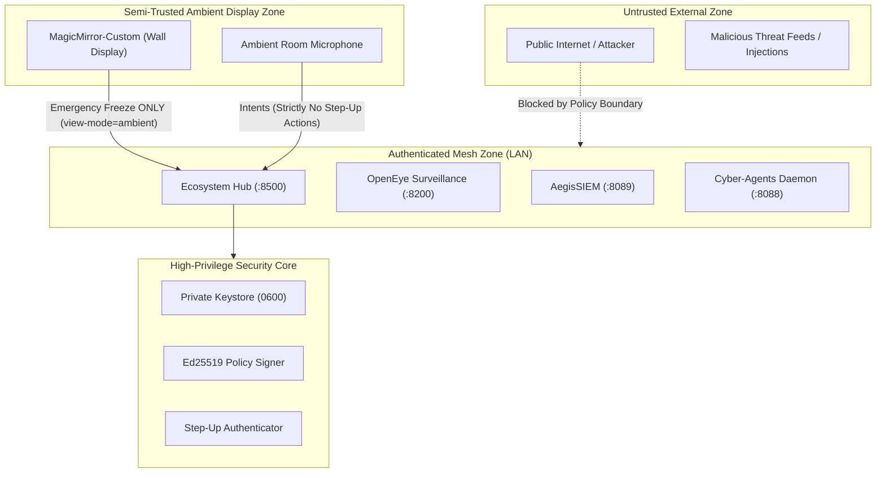

# Ecosystem Threat Model & STRIDE Analysis

This document provides the formal STRIDE threat model, boundary definitions, and defensive mitigations for the `appEcosystem` service mesh.

## Trust Boundaries & Zones

---

## STRIDE Threat Analysis

### 1. Spoofing (Identity Deception)
- **Threat**: An unauthorized device on the local Wi-Fi attempts to forge command envelopes or pose as the Ecosystem Hub.
- **Mitigation**:
  - Mutual HMAC-SHA256 request signing with high-entropy pre-shared secret.
  - Per-request timestamp verification (rejecting drift >300s) and unique nonce cache preventing replay attacks.
  - Ed25519 cryptographic signatures on all `policy.yaml` state declarations.

### 2. Tampering (Unauthorized Modification)
- **Threat**: An attacker modifies `policy.yaml` on disk to disable security restrictions (`Restrictions: Off`).
- **Mitigation**:
  - `PolicyEngine` validates the Ed25519 signature before applying any policy change.
  - If signature verification fails, `PolicyEngine` fails closed to conservative blue-team defaults.
  - Tamper-evident SHA-256 hash-chained audit logging.

### 3. Repudiation (Denying Action Execution)
- **Threat**: An operator or autonomous agent takes a disruptive action and denies responsibility.
- **Mitigation**:
  - Every decision, approval, freeze, and override is recorded in an immutable, append-only SQLite WAL database (`approvals.db`).
  - Records capture initiator identity, timestamp, authorization reference, and target details.

### 4. Information Disclosure (Sensitive Data Leakage)
- **Threat**: Surveillance camera footage, router connection logs, or full forensic scan outputs are leaked to third-party cloud GPUs or mesh peers.
- **Mitigation**:
  - `full.json` forensic reports encrypted at rest (`0600` key); only redacted `share.json` summaries published to event bus.
  - `ComputeBroker` enforces a hard data-release gate: workloads marked `sensitive` are blocked from cloud egress unless an operator issues a signed approval.

### 5. Denial of Service (Service Disruption)
- **Threat**: A rogue device floods the mesh with scan requests or repeatedly engages emergency freeze.
- **Mitigation**:
  - Single-flight per-device scan locks prevent endpoint CPU exhaustion.
  - Freeze requests are rate-limited and logged with channel and caller metadata.
  - Ambient wall displays (`MagicMirror-Custom`) cannot unfreeze the mesh. Resuming from Freeze strictly requires authenticated operator step-up (TOTP 2FA or Passkey).

### 6. Elevation of Privilege (Unauthorized Authority Escalation)
- **Threat**: An adversary uses voice commands ("resume", "turn restrictions off") or wall mirror taps to gain administrative control.
- **Mitigation**:
  - Voice recognition intents and ambient displays inherit zero administrative rights.
  - Privileged state transitions (resume, approve, deny, restrictions off) strictly reject ambient and voice callers with `ECOSYSTEM_POLICY_FORBIDDEN`.

